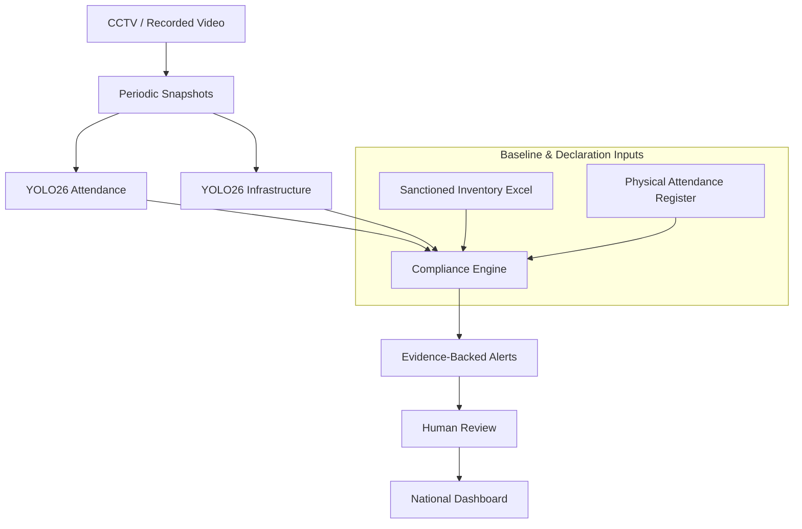

# System Data Flow & Lifecycle Specifications

**Product:** AI Training Centre Monitoring System  
**Document:** End-to-End Compliance Data Flow  
**Version:** 1.0.0  

---

## 1. High-Level Flowchart

---

## 2. Detailed 14-Step Data Lifecycle

### Step 1: Centre Creation
- **Actor:** System Administrator (`ADMIN`)
- **Action:** Submits institution details (Unique Centre Code, Facility Name, Operational Location).
- **Endpoint:** `POST /api/v1/centres/`
- **Database Entity:** `centres` table record (`status='ACTIVE'`).
- **Data Integrity:** Enforces unique constraint on `centre_code` (e.g., `TC-DEL-001`).

---

### Step 2: Camera Configuration
- **Actor:** System Administrator or Centre Supervisor (`ADMIN`, `CENTRE_USER`)
- **Action:** Binds on-premise monitoring sources (Classroom CCTV, Workshop Camera, Lab DVR) to the centre.
- **Endpoint:** `POST /api/v1/centres/{centre_id}/cameras`
- **Database Entity:** `cameras` table record (`source_type='VIDEO_FILE'|'CAMERA'`).
- **Data Integrity:** Camera references valid `centre_id` with foreign key cascade.

---

### Step 3: Inventory Excel Upload
- **Actor:** Administrator (`ADMIN`)
- **Action:** Uploads government-sanctioned equipment baseline spreadsheet (`.xlsx`).
- **Endpoint:** `POST /api/v1/inventory/centres/{centre_id}/upload-excel`
- **Processing:** OpenPyXL / Pandas validates headers (`item_name`, `category`, `expected_quantity`). Rows with invalid quantities or malformed columns are caught.
- **Database Entity:** `inventory_items` table (Creates or updates baseline equipment counts).
- **Transparency Notice:** Sanctioned quantities establish expected visual presence baseline.

---

### Step 4: Monitoring Session Initiation
- **Actor:** Authorized Centre User (`CENTRE_USER`)
- **Action:** Initializes an inspection session for a specific calendar date and camera.
- **Endpoint:** `POST /api/v1/monitoring/sessions`
- **Database Entity:** `monitoring_sessions` table (`status='PENDING'`).

---

### Step 5: Physical Attendance Entry
- **Actor:** Authorized Centre User (`CENTRE_USER`)
- **Action:** Submits the official physically recorded student attendance count (e.g., `22 Trainees`).
- **Endpoint:** Submitted during session creation or via `PATCH /api/v1/monitoring/sessions/{id}`.
- **Database Entity:** `monitoring_sessions.physical_attendance` (Integer count).
- **Privacy Standard:** Strictly an aggregate integer count—zero student roll numbers, biometric records, or names are accepted.

---

### Step 6: Video Upload
- **Actor:** Authorized Centre User (`CENTRE_USER`)
- **Action:** Uploads recorded MP4 classroom session footage.
- **Endpoint:** `POST /api/v1/monitoring/sessions/{id}/upload-video`
- **Storage:** Securely saved to `storage/videos/session_{id}/source_{hash}.mp4`.
- **Validation:** OpenCV parses container headers, verifying file integrity, FPS, duration in seconds, and resolution (`video_width`, `video_height`).
- **Database Update:** `monitoring_sessions.video_processing_status = 'COMPLETED'`.

---

### Step 7: Snapshot Generation
- **Actor:** Automated Video Engine
- **Action:** Extracts periodic video frames at uniform intervals (e.g., 1 frame per 30 seconds).
- **Endpoint:** `POST /api/v1/monitoring/sessions/{id}/process-video`
- **Storage:** Saved as JPEG images in `storage/snapshots/session_{id}/frame_{offset}.jpg`.
- **Database Entity:** `snapshots` table records (`monitoring_session_id`, `frame_number`, `timestamp_offset_seconds`, `file_path`).

---

### Step 8: Attendance AI Inference
- **Actor:** YOLO26 Attendance Pipeline
- **Action:** Asynchronously processes each snapshot frame with fine-tuned YOLO26 presence detection weights.
- **Endpoint:** `POST /api/v1/monitoring/sessions/{id}/attendance-ai`
- **Detection Output:** Trainee presence bounding boxes and aggregate count per frame.
- **Database Entity:** `attendance_observations` table (`detected_count`, `confidence_avg`, `bounding_boxes`).
- **Privacy Standard:** *"Attendance is estimated from periodic visual snapshots using YOLO26. The system does not identify individuals."*

---

### Step 9: Infrastructure AI Inference
- **Actor:** YOLO26 Infrastructure Pipeline
- **Action:** Asynchronously processes snapshot frames with YOLO26 infrastructure detection weights.
- **Endpoint:** `POST /api/v1/monitoring/sessions/{id}/infrastructure-ai`
- **Detection Output:** Visible asset classifications (Chairs, Computers, Workbenches, Safety Equipment).
- **Database Entity:** `infrastructure_observations` table (`inventory_item_id`, `detected_quantity`, `bounding_boxes`).
- **Transparency Notice:** *"Infrastructure observations are based on visual detection and do not establish mechanical or electrical functionality."*

---

### Step 10: Compliance Engine Evaluation
- **Actor:** Deterministic Compliance Engine
- **Action:** Executes mathematical variance comparison.
- **Endpoint:** `POST /api/v1/monitoring/sessions/{id}/compliance`
- **Calculations:**
  1. **Attendance Compliance:**
     $$\text{Difference} = |\text{Physical Attendance} - \text{AI Median Headcount}|$$
     $$\text{Status} = \begin{cases} \text{MATCH}, & \text{if Difference} \le \text{Tolerance} \\ \text{DISCREPANCY}, & \text{if Difference} > \text{Tolerance} \end{cases}$$
  2. **Infrastructure Compliance:**
     $$\text{Deficit} = \max(0, \text{Expected Quantity} - \text{AI Observed Quantity})$$
     $$\text{Status} = \begin{cases} \text{MATCH}, & \text{if Deficit} = 0 \\ \text{DISCREPANCY}, & \text{if Deficit} > 0 \end{cases}$$
- **Database Entities:** `attendance_compliance_results`, `infrastructure_compliance_results`.

---

### Step 11: Alert Generation
- **Actor:** Automated Compliance Engine
- **Action:** If discrepancies exist, generates prioritized compliance alerts.
- **Endpoint:** `POST /api/v1/alerts/generate`
- **Database Entity:** `alerts` table (`status='PENDING'`, `alert_type='ATTENDANCE_DISCREPANCY'|'INFRASTRUCTURE_DISCREPANCY'`).
- **Severity Logic:**
  - Variance $> 50\%$ or Missing safety gear $\rightarrow$ `HIGH`
  - Variance between $20\%-50\%$ $\rightarrow$ `MEDIUM`
  - Variance $< 20\%$ $\rightarrow$ `LOW`

---

### Step 12: Evidence Archiving
- **Actor:** Automated Alert Engine
- **Action:** Binds snapshot frames corresponding to discrepancy timestamps to the generated alert.
- **Storage:** Bounding-box annotated images stored in `storage/evidence/`.
- **Database Entity:** `alert_evidence` records (`alert_id`, `snapshot_id`, `annotated_file_path`, `explanation`).
- **Privacy Standard:** Monitoring uses aggregate visual counts and does not perform individual identity recognition.

---

### Step 13: Human Review Workflow
- **Actor:** Independent Government Audit Reviewer (`REVIEWER` or `ADMIN`)
- **Action:** Inspects alert evidence, reviews physical vs. observed metrics, and makes a formal audit determination.
- **Endpoint:** `PATCH /api/v1/alerts/{alert_id}/review`
- **Transitions:**
  - `PENDING` $\longrightarrow$ `VERIFIED` (Deficit confirmed; escalation required)
  - `PENDING` $\longrightarrow$ `FALSE POSITIVE` (Explained by scheduled break, occlusion, etc.)
- **Audit Logging:** Saves `reviewer_id`, `reviewed_at` timestamp, and mandatory explanatory comment.

---

### Step 14: Centralized Governance Dashboard
- **Actor:** State & National Regulators, Auditors, Centre Directors
- **Action:** Aggregates real-time compliance posture across all institutions.
- **Endpoint:** `GET /api/v1/dashboard/summary`, `GET /api/v1/dashboard/centres-overview`
- **Output:** Live metrics (Monitored Centres, Total Sessions, Pending Alerts, Compliance Distributions, Recent Activity Feed).
- **Result:** Complete transparency and governance integrity for public vocational funding.
